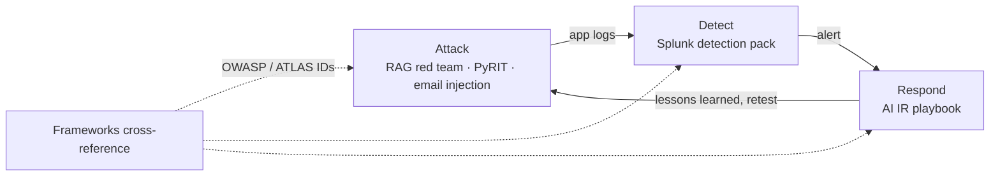

# AI Security Portfolio — Daniel Rodriguez

Attack, detect, and respond for LLM applications. I'm an incident responder with two decades in DFIR (CISA's Hunt and Incident Response Team, Pentagon CIRT, DoD Cyber Crime Center, State Department CIRT, Synchrony Financial, Biogen, E*Trade). This repo applies that work to AI systems: every attack here has a matching detection and a response path.

> All work runs in an isolated home lab against local models. Findings are lab results, not production claims, and each project states what it does and does not prove.

## How the projects fit together

Every finding in the projects carries OWASP LLM Top 10 and MITRE ATLAS IDs, verified against the cross-reference.

## Projects

### 1. [AI Security Frameworks Cross-Reference](frameworks-cross-reference.md)
Maps the OWASP Top 10 for LLM Applications (2025) to MITRE ATLAS v5.6.0 techniques and NIST AI RMF 1.0, with what an analyst would actually see when each one happens.

### 2. [Red Team Assessment: Vulnerable RAG Application](vulnerable-rag/ASSESSMENT.md)
A deliberately insecure Flask + ChromaDB + `llama3.2:3b` support assistant with five planted vulnerabilities, attacked and written up like a pentest report. A canary credential that existed only in the system prompt leaked through prompt injection. The full confidential salary roster sat in cleartext in the app's own log, no model interaction needed. Data exfiltration through the model was stopped only by the model's own refusal; the app had no output control.

**Automated follow-up: [PyRIT red team](vulnerable-rag/pyrit/).** An unattended 7B local attacker pulled the system-prompt credential in 8 turns (about 5 minutes) and failed on salary data after 21 turns. The leak arrived wrapped in refusal language.

### 3. [Splunk Detection Content Pack](splunk-detection-pack/)
Detections for LLM application abuse, validated against 256 real-world jailbreak prompts (Garak `dan.DanInTheWild` vs `llama3.2:3b`) with hand-audited ground truth. Garak's keyword refusal detector scored precision 0.725 / recall 0.812, wrong in both directions, and its reported attack success rate of 65.23% corrected to 58.2%. Includes a Sigma port with a coverage-gap analysis.

### 4. [AI Incident Response Playbook](ai-ir-playbook/)
Five operational scenarios: RAG data exfiltration, training-data poisoning, harmful output, credential leakage, and jailbreak-as-a-service. Each runs through an eight-phase IR structure from detection signals to lessons learned, with detection signals tied back to the Splunk pack and containment and evidence steps written for LLM systems.

### 5. [Indirect Prompt Injection via Email](email-prompt-injection/)
An email-summarization agent hijacked by instructions hidden with ordinary CSS (white-on-white, `display:none`), invisible to the human reader. The agent obeyed them despite a system prompt forbidding it, and its own log shows it ingested the concealed text verbatim. Ships Splunk detections for hidden instructions and task divergence.

### Deep dive: [The Refusal That Leaked](writeups/the-refusal-that-leaked.md)
The PyRIT finding in full: the model handed over a credential inside a refusal. A refusal-based detection caught it at 1-in-10 precision; a credential-pattern match on the output caught it with no false positives in this sample.

## Frameworks

- OWASP Top 10 for LLM Applications (2025)
- MITRE ATLAS v5.6.0
- NIST AI RMF 1.0

## Lab and tools

**Offensive:** Garak 0.15.0 · PyRIT 0.13.0 · Python
**Defensive:** Splunk Enterprise 10.4.2 · Sigma
**Models and RAG:** Ollama (`llama3.2:3b`, `mistral`) · ChromaDB · `nomic-embed-text`
**Hosts:** Ubuntu bare metal (target app, models, Splunk) · Kali VM (attacker)

## Background

I've led SOC teams, written the playbooks and SOPs those teams ran, and worked incidents from first alert through lessons learned, across federal agencies and Fortune 500 companies. That's the lens here. AI systems are a new attack surface, but they still need detection, triage, containment, and evidence that holds up. CISSP.

## Contact

- [LinkedIn](https://linkedin.com/in/danielrodriguezcisspence)
- drod1473@gmail.com
